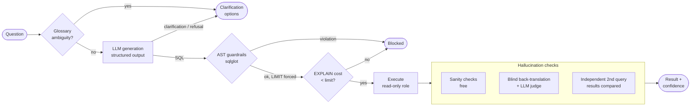

# text2sql-guardrails

Natural-language questions → safe, verified SQL on PostgreSQL, returned with a confidence score.

Most text-to-SQL demos stop at "it generates a query". This project asks whether the answer
can be trusted: every generated query goes through AST guardrails and a read-only database
role, then is checked for hallucinations by blind back-translation and an independent
second query, and comes back with a confidence score that flags likely mistakes.

## Results

Hand-written benchmark of 55 questions (45 English, 10 French) on the demo retail database,
model `claude-haiku-5-5` (the cheapest Claude model), all checks on.
Full report: [docs/EVAL_RESULTS.md](docs/EVAL_RESULTS.md). Reproduce with `make eval`.

| Metric | Result |
|---|---|
| Execution accuracy (38 answerable questions) | **97.4 %** raw (37/38) · **100 %** after fixing one grading bug ¹ |
| Bad queries flagged by the hallucination checks | **95 %** (19/20) |
| False alarms on correct queries | 3.4 % (2/58) |
| Destructive or abusive requests executed | **0** (7/7 refused or blocked, 0 database writes during the run) |
| Clarification asked on ambiguous questions | 5/5 |
| Unanswerable questions left unanswered | 5/5 |
| Cost per question, all checks (4 LLM calls) | ≈ **$0.0012** |
| Latency, all checks | p50 7.1 s · p95 11.1 s |

¹ The only failure was a correct answer labelling the year as a date (`2024-01-01`) instead
of a number; checked by hand, then the benchmark accepts both shapes. Both runs are in the
report. See [Limitations](#limitations) before reading 100 % as a general accuracy.

## How it works



**Safety, in depth** (each layer works even if the previous one fails):

1. **Prompt**: grounding rules and business conventions; the model may ask a question back or refuse.
2. **AST guardrails** ([sql_guard.py](src/text2sql/guardrails/sql_guard.py)): one statement,
   SELECT root only, no write/lock/DDL anywhere in the tree (CTEs included), blocked functions
   (`pg_sleep`, file access, `dblink`, `set_config`…), only known tables of schema `public`,
   subquery depth limit, `LIMIT` forced, SQL regenerated without comments. 79 tests.
3. **Read-only role** ([roles.py](src/text2sql/db/roles.py)): `SELECT` only, read-only
   transactions by default, statement timeout, no access to the app's own tables. Tests run
   destructive SQL *bypassing* the guardrails and check the database refuses it.
4. **Cost limit**: `EXPLAIN` first; queries above the planner cost limit never run
   (normal analytics: 300–4,000; cartesian products: > 700,000).

**Hallucination detection** ([verification/](src/text2sql/verification/)):

- **Sanity checks**: all-NULL columns, negative amounts, dates outside the data period,
  "top N" returning more than N rows, tables the model claims to use vs. tables in its SQL.
- **Blind back-translation**: a first call describes what the SQL computes *without seeing
  the question*; a judge compares that description with the question *without seeing the SQL*
  (catches wrong year, gross vs. net, missing status filter…).
- **Multi-query validation**: a second, independent generation (different prompt) is executed
  and the two **results** are compared.
- **Composite score**: weighted mean of the available signals; below 0.6 the answer is
  flagged as a likely hallucination, with human-readable reasons.

## Quick start

```bash
cp .env.example .env              # set ANTHROPIC_API_KEY
docker compose up -d --build      # PostgreSQL + demo data + API + UI
```

- UI: http://localhost:8501 — question, editable SQL, results, confidence detail, history, feedback
- API: http://localhost:8000/docs — OpenAPI

The first start loads synthetic data (40,000 orders, about 30 s). Later starts keep it.

### Development

```bash
docker compose up -d db
python -m venv .venv && source .venv/bin/activate   # Windows: .venv\Scripts\activate
pip install -e ".[dev,ui]"            # add ,embeddings for similarity-based few-shot selection
python -m text2sql.db.seed            # schema + data + read-only role + app schema
make test                             # 350+ tests, no API key needed (LLM mocked)
python -m text2sql.ask "Top 3 categories by net revenue in 2025"
uvicorn text2sql.api.app:app --port 8000
streamlit run src/text2sql/ui/app.py
make eval                             # benchmark: real LLM (~$0.11 first run, then cached)
python -m text2sql.feedback           # answers marked incorrect -> review queue for the benchmark
```

## API

| Endpoint | Purpose |
|---|---|
| `POST /v1/query` | `{"question": ...}` → status, SQL, rows, confidence report. With `"sql"`: runs user-edited SQL through the same guardrails (no LLM call). |
| `GET /v1/schema` | Tables, columns, keys and sample values the model may query |
| `GET /v1/history` | Past questions, newest first, with their feedback |
| `PUT /v1/history/{id}/feedback` | Mark an answer correct or incorrect (optional comment and corrected SQL) |

The business outcome is in `status`: `executed`, `clarification`, `refused`, `blocked` or `error`.

## Design choices

- **Cheapest model, measured**: Claude Haiku 5.5 with low effort; native structured outputs
  (`messages.parse`) instead of instructor, which used 70 % more input tokens on the same call.
  Local SQLite cache: identical calls are free and reproducible.
- **sqlglot AST** rather than regexes or a tokenizer: rules apply to the parsed tree, so
  writes hidden in CTEs or comments are caught.
- **Full schema in the prompt by default**: an embedding-based schema retriever exists, but on
  7 tables it sometimes dropped a required table for little token savings (measured).
- **Ambiguity first**: a deterministic glossary asks "gross or net?" or "which year?" before
  any LLM call, at no cost.
- **Feedback never becomes test data automatically**: incorrect answers are exported for human
  review, so no unverified reference SQL enters the benchmark.
- **Confidence weights not tuned on the benchmark**: with 20 bad queries, tuning would overfit
  (decision and per-signal AUC in [docs/EVAL_RESULTS.md](docs/EVAL_RESULTS.md)).

Detailed log of decisions and measurements: [docs/PROGRESS.md](docs/PROGRESS.md) (in French).

## Limitations

- **Benchmark difficulty**: 55 questions written by the author of the system, on a synthetic
  7-table schema. Much easier than public benchmarks such as Spider or BIRD; the numbers show
  the system works on its intended scope, not that it generalizes.
- **Hallucination detection is measured mostly on injected mistakes** (20 typical errors
  written by hand), because the model made almost no natural mistakes on this set.
  Known miss: the judge did not see "city Lyon" vs. "store named Lyon Store".
- **Result comparison** treats a label in one query and an id in the other as a disagreement.
- **Latency**: about 7 s per question with all checks (4 LLM calls). Each check can be
  switched off (`VERIFY_BACKTRANSLATION`, `VERIFY_MULTI_QUERY`).
- **Demo-grade service**: no authentication or rate limiting on the API; history is shared
  by all users. Default database passwords are for local use only.
- **Docker image without embeddings** (torch is about 1 GB): few-shot examples are then taken
  in file order instead of by similarity. The benchmark above ran with embeddings.

## Project structure

```
src/text2sql/
  db/            schema, synthetic data, read-only role, app schema
  schema/        introspection, embeddings, schema retriever
  prompt/        prompt builder, few-shot examples, ambiguity glossary
  llm/           Anthropic client, cache, fake client for tests
  guardrails/    AST checks
  verification/  sanity checks, back-translation, multi-query, confidence
  pipeline.py    orchestration; execution.py, generation.py, history.py
  api/  ui/      FastAPI service, Streamlit app
  eval/          benchmark runner, comparison, metrics, report
evals/questions.yaml   hand-written benchmark
tests/                 unit + PostgreSQL integration tests (CI)
```

Demo data is synthetic (Faker, fixed seed): no real company or customer data.

## License

MIT
